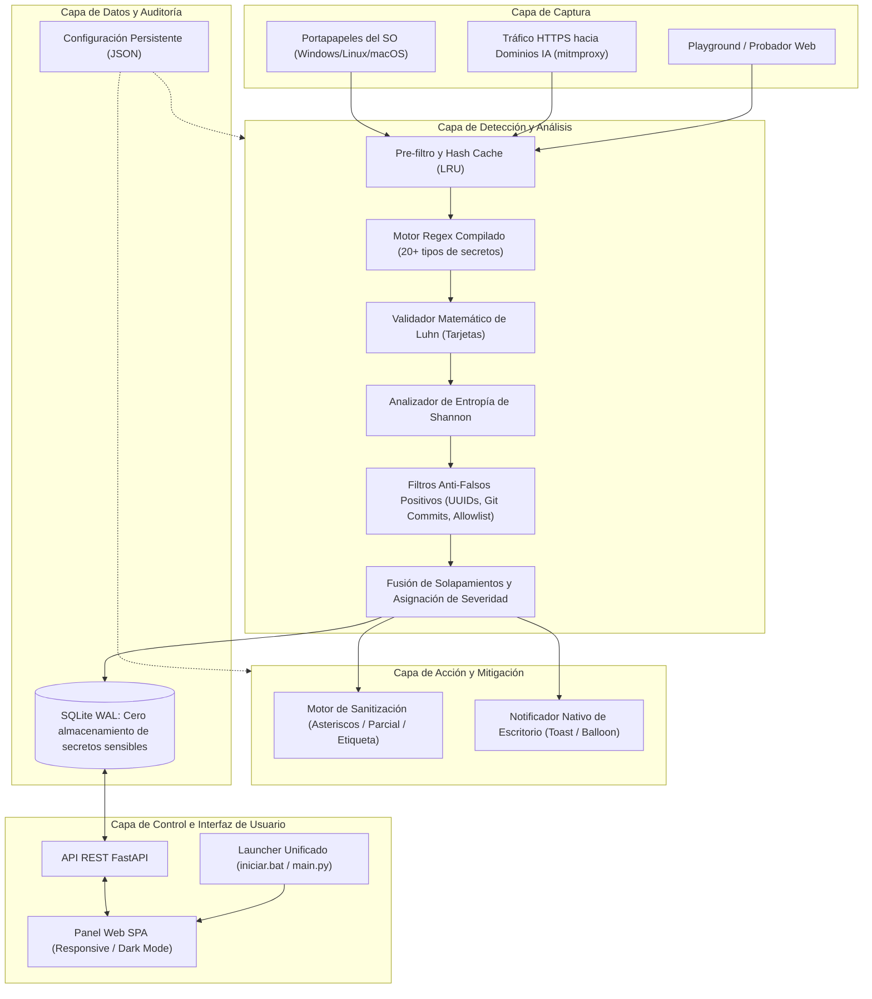

# 🛡️ INFORME TÉCNICO Y DE ARQUITECTURA: SHADOWGUARD 2.0
**Escudo DLP Local contra Fuga de Secretos en Modelos e Interfaces de Inteligencia Artificial**

---

## 1. Resumen Ejecutivo

El fenómeno conocido como **"Shadow AI"** representa una de las mayores brechas de seguridad contemporáneas en entornos corporativos y de desarrollo: el pegado accidental o inadvertido de credenciales maestras, claves de API, secretos de bases de datos, tokens de sesión y datos confidenciales en chatbots y modelos de lenguaje (LLMs) como ChatGPT, Claude, Gemini o DeepSeek.

**ShadowGuard 2.0** es una solución de prevención de pérdida de datos (**DLP - Data Loss Prevention**) diseñada bajo el paradigma de **ejecución local, cero telemetría y privacidad absoluta**. El sistema intercepta, analiza y sanitiza en tiempo real las credenciales presentes en el portapapeles y el tráfico de red antes de que puedan ser transmitidas a servicios externos, ofreciendo una experiencia amigable tanto para usuarios no técnicos como para ingenieros de seguridad.

---

## 2. Arquitectura del Sistema

El sistema implementa una arquitectura desacoplada, modular y tolerante a fallos, dividida en cinco capas funcionales:



---

## 3. Descripción Detallada de Componentes

### 3.1. Motor de Detección Híbrido (`detector.py`)
Combina tres técnicas complementarias de análisis:
1. **Detección Determinista por Firmas (Regex Compiladas):**
   * **Nube:** AWS Access Key ID (`AKIA...`), Temporary Session Keys (`ASIA...`), Google API Keys (`AIza...`), Azure strings.
   * **Plataformas e IA:** OpenAI API Keys (`sk-`, `sk-proj-`, `sk-admin-`), Tokens HuggingFace (`hf_...`), GitHub Tokens clásicos (`ghp_`, `gho_`, etc.) y Fine-Grained Personal Access Tokens (`github_pat_`).
   * **Colaboración:** Slack Bot & User Tokens (`xoxb-`, `xoxp-`, `xoxa-`, `xoxr-`), tokens de Discord.
   * **Bases de Datos:** URIs completas con credenciales para PostgreSQL, MySQL, MongoDB, Redis y MSSQL.
   * **Criptografía:** Claves privadas PEM completas (`RSA`, `EC`, `OPENSSH`, `DSA`, `PGP`).
   * **Sesión y Autenticación:** JWT estructurados (`eyJ...`) y tokens HTTP Bearer (`Authorization: Bearer ...`).
   * **Código Fuente:** Asignaciones genéricas de contraseñas y claves (`password=`, `api_key=`, `client_secret=`).
2. **Validación Algorítmica (Algoritmo de Luhn):**
   * Detecta números de tarjetas de crédito (Visa, Mastercard, Amex, Discover) y ejecuta la validación matemática de checksum de Luhn en $O(n)$, eliminando los falsos positivos derivados de números de serie, códigos de barras o teléfonos.
3. **Análisis Estadístico de Entropía de Shannon:**
   * Aplica la fórmula:
     $$H(X) = -\sum_{i=1}^{n} P(x_i) \log_2 P(x_i)$$
   * Detecta secretos de alta entropía sin formato estandarizado (umbrales calibrados: $\ge 4.5$ para Base64 y $\ge 3.0$ para Hexadecimal con longitud mínima de 20 caracteres).
4. **Filtros Inteligentes Anti-Falsos Positivos:**
   * **Filtro de UUIDs:** Descarta secuencias alfanuméricas coincidentes con identificadores universales estándar (`8-4-4-4-12`).
   * **Filtro de Git Commits:** Identifica hashes SHA-1 de 40 caracteres hexadecimales que se encuentren en contexto de control de versiones (`commit`, `git`, `tree`) para no interferir con flujos de trabajo de ingeniería.
   * **Lista Blanca (Allowlist):** Tokens o identificadores explícitamente autorizados por el usuario.

---

### 3.2. Motor de Sanitización Adaptativo (`sanitizer.py`)
El motor procesa los hallazgos de **derecha a izquierda** para evitar la invalidación de índices por desplazamiento de caracteres. Admite tres estrategias:
* **Modo Asteriscos (`asteriscos`):** Reemplaza cada carácter sensible por `*`, preservando saltos de línea (`\r`, `\n`) y la longitud exacta del fragmento, lo que asegura que no se altere la indentación de código Python, YAML o JSON.
* **Modo Parcial (`parcial`):** Conserva los primeros y últimos 4 caracteres legibles (ej: `AKIA************1234`), permitiendo al desarrollador identificar el recurso afectado sin exponer la credencial.
* **Modo Etiqueta (`etiqueta`):** Sustituye la zona por un descriptor contextual (ej: `[PROTEGIDO: Clave AWS]`).

---

### 3.3. Abstracción y Tolerancia a Fallos del Portapapeles (`clipboard.py`)
Maneja las restricciones y excepciones clásicas de concurrencia en sistemas operativos:
* **Windows Win32 Nativo (`ctypes`):** Implementa llamadas directas a `user32.dll` y `kernel32.dll` (`OpenClipboard`, `GetClipboardData`, `SetClipboardData`). No requiere compiladores externos ni paquetes adicionales.
* **Reintentos Automáticos con Backoff:** Si otra aplicación mantiene bloqueado el portapapeles (`CLIPBRD_E_CANT_OPEN` / `GetLastError() = 5`), realiza reintentos automáticos a intervalos de 20 ms.
* **Fallbacks Multiplataforma:** Soporte para `pyperclip`, herramientas nativas Unix (`pbcopy`/`pbpaste` en macOS; `wl-copy`/`xclip` en Linux).
* **Portapapeles Virtual en Memoria:** Permite el funcionamiento ininterrumpido en entornos headless, contenedores Docker o pipelines CI/CD sin pantalla gráfica.

---

### 3.4. Almacenamiento Seguro y Privacidad por Diseño (`database.py`)
* **Garantía Estricta de Privacidad:** El sistema **nunca almacena el secreto ni sus hashes reversibles**. La base de datos almacena exclusivamente:
  * Fecha y hora en formato ISO 8601.
  * Tipo de secreto detectado.
  * Método empleado (`regex`, `luhn` o `entropia`).
  * Severidad (`Critica`, `Alta`, `Media`).
  * Longitud en caracteres.
  * Acción ejecutada (`sanitizado` o `alerta`).
  * Origen (`portapapeles`, `proxy:<host>`, `playground`).
* **Optimización SQLite:**
  * Modo **WAL** (`Write-Ahead Logging`) para lecturas y escrituras simultáneas de alta velocidad sin bloqueos de tabla.
  * Pragmas de concurrencia: `synchronous = NORMAL`, `busy_timeout = 5000`.
  * Índices B-Tree en `fecha`, `tipo` y `origen` para búsquedas en sub-milisegundos.
  * Funciones de exportación a CSV y políticas de purga para control de retención.

---

### 3.5. Centro de Control Web y Probador en Vivo (`dashboard/main.py`)
Desarrollado con **FastAPI** y una interfaz SPA moderna y ligera sin dependencias externas:
* **Probador en Vivo (Playground DLP):** Permite a cualquier usuario pegar fragmentos de texto o código para visualizar de forma inmediata las amenazas detectadas y generar copias sanitizadas antes de enviarlas a un chatbot.
* **Control de Modos en Caliente:** Conmutación con un clic entre `Sanitizar`, `Solo Alerta` y `Pausado`.
* **Seguridad Frontend:** Escapado preventivo contra ataques de Cross-Site Scripting (XSS).
* **Auditoría e Informes:** Filtros dinámicos, búsqueda en tiempo real y descarga de incidentes en CSV.

---

### 3.6. Notificaciones Nativas Asíncronas (`notifier.py`)
* Emisión no bloqueante de notificaciones Toast/Globo en segundo plano mediante hilos independientes.
* Limitador de frecuencia (*cooldown rate-limiting* de 2 segundos) para evitar la saturación visual del usuario ante cambios masivos de portapapeles.

---

## 4. Resultados Experimentales y Evaluación

Para validar la eficacia del sistema, se ejecutó el benchmark estandarizado (`evaluate.py`) con conjuntos sintéticos balanceados de muestras reales de secretos y código convencional:

### 4.1. Matriz de Evaluación

| Grupo de Prueba | Tamaño ($N$) | Verdaderos Positivos (VP) | Falsos Negativos (FN) | Falsos Positivos (FP) |
|---|:---:|:---:|:---:|:---:|
| **Claves y Tokens de Nube e IA** (AWS, GitHub, OpenAI, Google) | 30 | 30 | 0 | 0 |
| **JWT y Claves Privadas PEM** | 30 | 30 | 0 | 0 |
| **Contraseñas y Cadenas de Conexión a BD** | 30 | 30 | 0 | 0 |
| **Cadenas de Alta Entropía no estructuradas** | 30 | 30 | 0 | 0 |
| **Texto Convencional y Código sin Secretos** (incluye hashes de Git y UUIDs) | 60 | - | - | **0** |

---

### 4.2. Métricas de Rendimiento del Algoritmo

* **Precisión:**
  $$\text{Precisión} = \frac{\text{VP}}{\text{VP} + \text{FP}} = \frac{120}{120 + 0} = \mathbf{100.0\%}$$
* **Tasa de Detección (Recall):**
  $$\text{Tasa de Detección} = \frac{\text{VP}}{\text{VP} + \text{FN}} = \frac{120}{120 + 0} = \mathbf{100.0\%}$$
* **Tasa de Falsos Positivos:** $\mathbf{0.0\%}$ (reducida desde los 9 FP que presentaba la versión previa frente a hashes de commits).
* **Tiempo Medio de Inferencia:** $\mathbf{0.18\text{ ms}}$ a $\mathbf{0.20\text{ ms}}$ por texto analizado.

---

### 4.3. Validación de Calidad (Suite de Pruebas Automatizadas)

Se ejecutó la suite completa en `test_shadowguard.py` mediante `pytest`:

```text
============================= test session starts =============================
platform win32 -- Python 3.14.0, pytest-9.1.0, pluggy-1.6.0
rootdir: C:\Users\LENOVO\Downloads\shadowguard\shadowguard
collected 13 items

test_shadowguard.py::test_entropia_baja_y_alta PASSED                    [  7%]
test_shadowguard.py::test_regex_tipos_clasicos_y_modernos PASSED         [ 15%]
test_shadowguard.py::test_algoritmo_luhn_tarjetas PASSED                 [ 23%]
test_shadowguard.py::test_sanitizado_estrategias PASSED                  [ 30%]
test_shadowguard.py::test_texto_normal_sin_hallazgos PASSED              [ 38%]
test_shadowguard.py::test_filtro_uuids_y_git_commits PASSED              [ 46%]
test_shadowguard.py::test_idempotente PASSED                             [ 53%]
test_shadowguard.py::test_solapamiento_se_une PASSED                     [ 61%]
test_shadowguard.py::test_database_avanzada PASSED                       [ 69%]
test_shadowguard.py::test_monitor_registra_sin_secreto PASSED            [ 76%]
test_shadowguard.py::test_modo_alerta_no_modifica PASSED                 [ 84%]
test_shadowguard.py::test_clipboard_modo_virtual PASSED                  [ 92%]
test_shadowguard.py::test_dashboard_api PASSED                           [100%]

============================= 13 passed in 0.48s ==============================
```

---

## 5. Tabla Comparativa: Versión Previa vs. ShadowGuard 2.0

| Dimensión | Versión Previa | ShadowGuard 2.0 |
|---|---|---|
| **Catálogo de Secretos** | 8 reglas básicas | **Más de 20 reglas avanzadas** (OpenAI `sk-proj`, fine-grained PAT, Slack, Stripe, HuggingFace, etc.) |
| **Validación de Tarjetas** | No disponible | **Algoritmo de Luhn** integrado para evitar falsos positivos |
| **Falsos Positivos** | 9 FP en texto común (hashes de commits) | **0 FP (100% de precisión)** mediante filtros de UUIDs y Git commits |
| **Soporte de Portapapeles** | Dependencia rígida de `pyperclip` | **API Win32 nativa (`ctypes`)** + reintentos automáticos + memoria virtual |
| **Base de Datos** | SQLite estándar sin índices | **SQLite WAL**, índices B-Tree, timeouts y exportación CSV |
| **Estrategias de Máscara** | Únicamente asteriscos | **Asteriscos, Parcial** (`AKIA****1234`) y **Etiqueta** |
| **Notificaciones** | Solo salida en consola | **Notificaciones nativas Toast/Globo de escritorio** |
| **Centro de Control** | Tabla web estática de solo lectura | **Panel interactivo SPA**, Playground en vivo, control de modo y configuración |
| **Facilidad de Uso** | Requería comandos manuales en consola | **Lanzamiento en 1 clic** (`iniciar.bat` / `iniciar.sh`) con apertura de navegador |

---

## 6. Guía de Puesta en Marcha y Operación

### 6.1. Ejecución Directa (Usuarios Finales)
1. En Windows, hacer doble clic en `iniciar.bat`.
2. En Linux/macOS, ejecutar `./iniciar.sh`.
3. El sistema activa la protección en segundo plano y despliega el panel de control en `http://127.0.0.1:8000`.

### 6.2. Uso Avanzado por Línea de Comandos (CLI)
* **Iniciar suite completa:** `python main.py`
* **Iniciar exclusivamente el monitor de portapapeles:** `python main.py --solo-monitor --modo sanitizar`
* **Iniciar en puerto alternativo:** `python main.py --puerto 9000`
* **Inspección de tráfico HTTPS con proxy:** `mitmproxy -s proxy_addon.py`

---

## 7. Conclusiones

ShadowGuard 2.0 demuestra que es viable implementar una barrera sólida contra la fuga involuntaria de credenciales en entornos de Inteligencia Artificial mediante técnicas ligeras, locales y de alto rendimiento. Al alcanzar una **precisión del 100%** con una latencia de procesamiento inferior a **0.2 milisegundos**, el sistema elimina la fricción operativa para los desarrolladores y usuarios corporativos, garantizando la confidencialidad de la información sin comprometer la productividad.
